# ironbridge

[](https://github.com/hsiddhu2/ironbridge/actions/workflows/ci.yml)
[](LICENSE)


## What this is

`ironbridge jcl to-asl` turned CardDemo's 38 JCL jobs into AWS Step Functions. 497 of 511 JCL constructs (97.3%) came out with no TODO marker. Program bodies run on a return-code stub in v0.1.0.

Companion repo for the article on AWS Builder Center: {{ARTICLE_URL}}

ironbridge is one CLI for mainframe artifacts in and AWS targets out. v0.1.0 ships the `jcl` group. Later releases add `vsam`, `cobol`, `ebcdic`, `cics` and `transform` as sibling packages under `ironbridge/`. The `jcl` details are in [`ironbridge/jcl/README.md`](ironbridge/jcl/README.md).

## Architecture

```mermaid
flowchart LR
  SRC["CardDemo JCL, PROC, Control-M XML"] -->|source text| CLI["ironbridge jcl to-asl"]
  CLI -->|ASL JSON| BUILD["build/ folder"]
  CLI -->|TODO inventory| COV["coverage.json"]
  BUILD -->|definitions| CDK["AWS CDK deploy"]
  CDK -->|cron, DISABLED| SCH["Amazon EventBridge Scheduler"]
  SCH -->|StartExecution| PARENT["AWS Step Functions folder parent"]
  PARENT -->|startExecution.sync:2| JOB["AWS Step Functions job"]
  JOB -->|step, pgm, dd| STUB["AWS Lambda RC stub"]
  STUB -->|rc or Abend| JOB
  JOB -->|execution logs| CWL["Amazon CloudWatch Logs"]
  STUB -->|function logs| CWL
  OP["Operator, AWS_PROFILE=sandbox"] -->|RedriveExecution| JOB
```



The converter runs offline and writes one JSONata state machine per job, one parent per Control-M folder, Scheduler definitions and `coverage.json`. The CDK stack deploys TRANBKP, DEFGDGD, TRANREPT and the DAILY-TransactionBackup folder parent with the jobs it calls. A Lambda stub returns the RC for each step so COND, GDG and redrive run for real.

## Prerequisites

- Python 3.12 and [uv](https://docs.astral.sh/uv/)
- Node 22 or 24. The CDK CLI is pinned in `infra/package.json` and runs through `npx`. `make node-check` runs before `install`, `synth`, `deploy` and `destroy`. On Node 20 it prints a warning and carries on. Every target still works, but the CDK CLI prints an end-of-life banner on each command. Below Node 20 it stops. Switch with `nvm install 22 && nvm use 22`
- An AWS profile with admin rights in a sandbox account. `aws sts get-caller-identity` must work. A missing profile or an expired SSO session prints one `error:` line and exits 2
- Region `us-east-1` by default. The CDK app and every script read `AWS_REGION`, then `AWS_DEFAULT_REGION`, then `region` in `infra/cdk.json` context, then fall back to `us-east-1`. Deploy, run and measure in the same region. The scripts stop if `outputs.json` points at another region. The measurement plan is only valid in `us-east-1`, so `make measure` warns anywhere else
- A CDK bootstrap in that account and region. `make bootstrap` once if the `CDKToolkit` stack is missing
- An AWS Budget alarm. This deploys billable resources

## Deploy

```bash
export AWS_PROFILE=sandbox
make install
make deploy
```

`make deploy` runs the converter into `build/`, then `cdk deploy`. Stack outputs go to `outputs.json`.

## Run

Offline, no AWS needed:

```bash
make build
```

It prints the coverage table and writes `build/`. Two runs give byte-identical output.

Against the deployed stack:

```bash
make run
```

It starts the DAILY-TransactionBackup parent once and prints the jobs it ran.

To inject an abend by hand, set `ABEND_STEPS` on the stub Lambda (`StubFunctionName` in `outputs.json`). The value is a comma list of `JOB.STEP` keys, for example `TRANBKP.STEP05` or `TRANREPT.STEP05R`. Start the job, watch it fail, set `ABEND_STEPS` back to empty, then redrive the same execution. No redeploy is needed.

```bash
FN=$(python3 -c 'import json; print(json.load(open("outputs.json"))["ironbridge-m4"]["StubFunctionName"])')
aws lambda update-function-configuration --function-name "$FN" \
  --environment 'Variables={ABEND_STEPS=TRANBKP.STEP05,LOG_LEVEL=INFO}'
```

`update-function-configuration` replaces the whole environment, so keep `LOG_LEVEL` in the list.

## Measure

```bash
make measure
```

It runs the four phases of [`docs/measurement-plan.md`](docs/measurement-plan.md) and appends to `results.csv`. Each `make measure` stamps its rows with one run label, so `run_id` is `<UTC start>-<phase>-<nnn>`, for example `20261102T013000Z-run-007`. Three runs leave three groups of rows. Delete `results.csv` to start fresh. If the file has other columns, the script leaves it alone and writes `results-<UTC start>.csv`.

| Phase | Needs AWS | What it does |
| --- | --- | --- |
| `coverage` | No | Runs the converter twice, checks byte-identical output and that the TODO grep equals `coverage.json` |
| `validate` | Yes | `ValidateStateMachineDefinition` at severity WARNING on 38 jobs and 5 parents |
| `diff` | No | State types and transition edges against the hand-written baselines |
| `run` | Deployed | 3 jobs x 3 runs: all RC 0, a COND trip, then an abend cleared and redriven |

Run one phase with `uv run python scripts/measure.py coverage`. The operator identity needs the `OperatorPolicyArn` policy from `outputs.json` or admin rights. The `run` phase edits the stub's `ABEND_STEPS` environment variable, so it needs `lambda:GetFunctionConfiguration` and `lambda:UpdateFunctionConfiguration`. The operator policy grants both on the stub only.

Redrive reruns are read from `GetExecutionHistory`. Redrive does not emit a second `TaskStateEntered` for the failed step. It schedules the Task again. So `steps_rerun` lists each `TaskScheduled` after `ExecutionRedriven` whose state was entered before the redrive. `path_match` is true only when the path matches the baseline with that step twice and nothing else reran.

## Destroy

```bash
make destroy
make leftovers
```

`make leftovers` lists any stack, state machine, function, schedule, log group, role or policy still named after the stack. It exits 1 if it finds one.

## Cost

Under $1 for a full deploy, measure and destroy cycle in `us-east-1`. Charges are Step Functions Standard state transitions, Lambda requests and CloudWatch Logs ingestion. The schedule is DISABLED. Nothing is always on. The CDK bootstrap bucket stays after destroy and costs pennies.

## Cleanup warning

Do not leave this deployed. Run `make destroy`, then `make leftovers` and confirm it prints `clean`.

## License

Apache 2.0. See `LICENSE`. CardDemo fixtures under `ironbridge/jcl/tests/fixtures/carddemo/` come from [aws-samples/aws-mainframe-modernization-carddemo](https://github.com/aws-samples/aws-mainframe-modernization-carddemo) at commit 59cc6c2, Apache 2.0, with their own `LICENSE` and `NOTICE`.
