# ironbridge

[](https://github.com/hsiddhu2/ironbridge/actions/workflows/ci.yml)
[](LICENSE)


## What this is

`ironbridge jcl to-asl` turned CardDemo's 38 JCL jobs and its Control-M schedule into AWS Step Functions, and {{COVERAGE_PCT}}% of {{CONSTRUCT_TOTAL}} JCL constructs converted with no hand edit.

Companion repo for the article on AWS Builder Center: {{ARTICLE_URL}}

ironbridge is one CLI for mainframe artifacts in and AWS targets out. v0.1.0 ships the `jcl` group. Later releases add `vsam`, `cobol`, `ebcdic`, `cics` and `transform` as sibling packages under `ironbridge/`. The `jcl` details are in [`ironbridge/jcl/README.md`](ironbridge/jcl/README.md).

## Architecture

```mermaid
flowchart LR
  SRC["CardDemo JCL, PROC, Control-M XML"] -->|source text| CLI["ironbridge jcl to-asl"]
  CLI -->|ASL JSON| BUILD["build/ folder"]
  CLI -->|TODO inventory| COV["coverage.json"]
  BUILD -->|definitions| CDK["AWS CDK deploy"]
  CDK -->|cron, DISABLED| SCH["Amazon EventBridge Scheduler"]
  SCH -->|StartExecution| PARENT["AWS Step Functions folder parent"]
  PARENT -->|startExecution.sync:2| JOB["AWS Step Functions job"]
  JOB -->|step, pgm, dd| STUB["AWS Lambda RC stub"]
  STUB -->|rc or Abend| JOB
  JOB -->|execution logs| CWL["Amazon CloudWatch Logs"]
  STUB -->|function logs| CWL
  OP["Operator, AWS_PROFILE=sandbox"] -->|RedriveExecution| JOB
```



The converter runs offline and writes one JSONata state machine per job, one parent per Control-M folder, Scheduler definitions and `coverage.json`. The CDK stack deploys TRANBKP, DEFGDGD, TRANREPT and the DAILY-TransactionBackup folder parent with the jobs it calls. A Lambda stub returns the RC for each step so COND, GDG and redrive run for real.

## Prerequisites

- Python 3.12 and [uv](https://docs.astral.sh/uv/)
- Node 22 or 24. The CDK CLI is pinned in `infra/package.json` and runs through `npx`
- An AWS profile with admin rights in a sandbox account. `aws sts get-caller-identity` must work
- Region `us-east-1`. It is set in `infra/cdk.json` context
- A CDK bootstrap in that account and region. `make bootstrap` once if the `CDKToolkit` stack is missing
- An AWS Budget alarm. This deploys billable resources

## Deploy

```bash
export AWS_PROFILE=sandbox
make install
make deploy
```

`make deploy` runs the converter into `build/`, then `cdk deploy`. Stack outputs go to `outputs.json`.

## Run

Offline, no AWS needed:

```bash
make build
```

It prints the coverage table and writes `build/`. Two runs give byte-identical output.

Against the deployed stack:

```bash
make run
```

It starts the DAILY-TransactionBackup parent once and prints the jobs it ran.

## Measure

```bash
make measure
```

It runs the four phases of [`docs/measurement-plan.md`](docs/measurement-plan.md) and writes `results.csv`.

| Phase | Needs AWS | What it does |
| --- | --- | --- |
| `coverage` | No | Runs the converter twice, checks byte-identical output and that the TODO grep equals `coverage.json` |
| `validate` | Yes | `ValidateStateMachineDefinition` at severity WARNING on 38 jobs and 5 parents |
| `diff` | No | State types and transition edges against the hand-written baselines |
| `run` | Deployed | 3 jobs x 3 runs: all RC 0, a COND trip, then an abend cleared and redriven |

Run one phase with `uv run python scripts/measure.py coverage`. The operator identity needs the `OperatorPolicyArn` policy from `outputs.json` or admin rights.

## Destroy

```bash
make destroy
make leftovers
```

`make leftovers` lists any stack, state machine, function, schedule, log group, role or policy still named after the stack. It exits 1 if it finds one.

## Cost

Under $1 for a full deploy, measure and destroy cycle in `us-east-1`. Charges are Step Functions Standard state transitions, Lambda requests and CloudWatch Logs ingestion. The schedule is DISABLED. Nothing is always on. The CDK bootstrap bucket stays after destroy and costs pennies.

## Cleanup warning

Do not leave this deployed. Run `make destroy`, then `make leftovers` and confirm it prints `clean`.

## License

Apache 2.0. See `LICENSE`. CardDemo fixtures under `ironbridge/jcl/tests/fixtures/carddemo/` come from [aws-samples/aws-mainframe-modernization-carddemo](https://github.com/aws-samples/aws-mainframe-modernization-carddemo) at commit 59cc6c2, Apache 2.0, with their own `LICENSE` and `NOTICE`.
