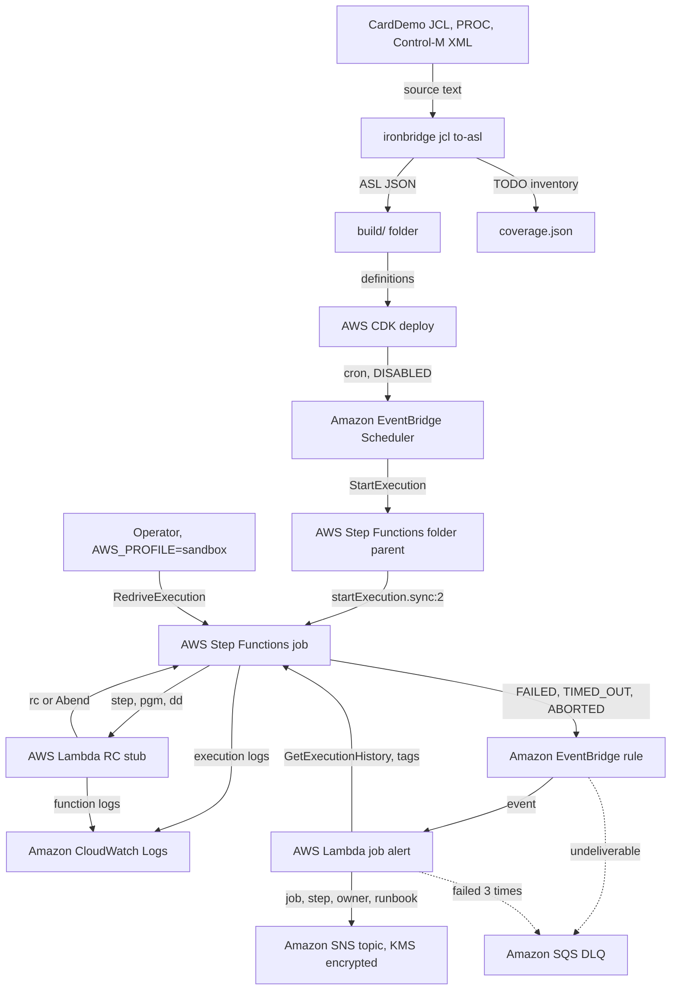

# Demo 01: JCL and Control-M to AWS Step Functions

[`ironbridge jcl to-asl`](../../ironbridge/jcl/README.md) turned CardDemo's 38 JCL jobs into AWS Step Functions. It converts the job flow, not the programs inside the steps. It handled 497 of 511 JCL constructs automatically. That is 97.3%. It flagged the other 14 for a person to finish. The tool's output calls these flags TODO markers. The Control-M schedule converted at a lower rate, 62 of 85 constructs, or 72.9%. Program bodies run on a return-code stub in v0.1.x.

Since v0.1.2, a failed, timed out or aborted job sends one alert to an Amazon SNS topic. The alert names the job, the failed step, the error, the owner and the runbook, with a console link and the redrive command. See [failure alerts and job owners](docs/deep-dive.md#failure-alerts-and-job-owners-added-in-v012).

Article on AWS Builder Center: [How to Move Mainframe Batch Jobs to AWS Step Functions, Step by Step](https://builder.aws.com/content/3LlXuZLqO9UuZeiOq2vi5aJrGWi/how-to-move-mainframe-batch-jobs-to-aws-step-functions-step-by-step). The [deep dive](docs/deep-dive.md) covers the schedule, running it on your own JCL, what broke and production notes.

Run every command below from this folder:

```bash
cd demos/01-jcl-to-asl
```

## Architecture



The converter runs offline and writes one JSONata state machine per job, one parent per Control-M folder, Scheduler definitions and `coverage.json`. The CDK stack deploys TRANBKP, DEFGDGD, TRANREPT and the DAILY-TransactionBackup folder parent with the jobs it calls. A Lambda stub returns the RC for each step so COND, GDG and redrive run for real. An EventBridge rule sends failed runs of these state machines to an alert Lambda, which finds the failed step and publishes to SNS. Each state machine carries its owner and runbook as tags, read from `owners.json`.

## Prerequisites

- Python 3.12 and [uv](https://docs.astral.sh/uv/)
- Node 22 or 24. The CDK CLI is pinned in `infra/package.json` and runs through `npx`. `make node-check` runs before `install`, `synth`, `deploy` and `destroy`. On Node 20 it prints a warning and carries on. Every target still works, but the CDK CLI prints an end-of-life banner on each command. Below Node 20 it stops. Switch with `nvm install 22 && nvm use 22`
- An AWS profile with admin rights in a sandbox account. `aws sts get-caller-identity` must work. A missing profile or an expired SSO session prints one `error:` line and exits 2
- Region `us-east-1` by default. The CDK app and every script read `AWS_REGION`, then `AWS_DEFAULT_REGION`, then `region` in `infra/cdk.json` context, then fall back to `us-east-1`. Deploy, run and measure in the same region. The scripts stop if `outputs.json` points at another region. The measurement plan is only valid in `us-east-1`, so `make measure` warns anywhere else
- A CDK bootstrap in that account and region. `make bootstrap` once if the `CDKToolkit` stack is missing
- An AWS Budget alarm. This deploys billable resources

## Deploy

```bash
export AWS_PROFILE=sandbox
make install
make deploy
```

`make deploy` runs the converter into `build/`, then `cdk deploy`. Stack outputs go to `outputs.json`.

To get alerts by email, pass an address. Nothing is subscribed otherwise. SNS sends a confirmation mail first.

```bash
ALERT_EMAIL=you@example.com make deploy
```

Owners and runbooks come from `owners.json` in this folder. A job not listed there gets `unassigned`, because the CardDemo JOB cards say `NOTIFY=&SYSUID`, which z/OS fills with whoever submits the job.

## Run

Offline, no AWS needed:

```bash
make build
```

It prints the coverage table and writes `build/`. Two runs give byte-identical output.

Against the deployed stack:

```bash
make run
```

It starts the DAILY-TransactionBackup parent once and prints the jobs it ran.

To inject an abend by hand, set `ABEND_STEPS` on the stub Lambda (`StubFunctionName` in `outputs.json`). The value is a comma list of `JOB.STEP` keys, for example `TRANBKP.STEP05` or `TRANREPT.STEP05R`. Start the job, watch it fail, set `ABEND_STEPS` back to empty, then redrive the same execution. No redeploy is needed.

```bash
FN=$(python3 -c 'import json; print(json.load(open("outputs.json"))["ironbridge-m4"]["StubFunctionName"])')
aws lambda update-function-configuration --function-name "$FN" \
  --environment 'Variables={ABEND_STEPS=TRANBKP.STEP05,LOG_LEVEL=INFO}'
```

`update-function-configuration` replaces the whole environment, so keep `LOG_LEVEL` in the list.

## Measure

```bash
make measure
```

It runs the four phases of [`docs/measurement-plan.md`](docs/measurement-plan.md) and appends to `results.csv`. Each `make measure` stamps its rows with one run label, so `run_id` is `<UTC start>-<phase>-<nnn>`, for example `20261102T013000Z-run-007`. Three runs leave three groups of rows. Delete `results.csv` to start fresh. If the file has other columns, the script leaves it alone and writes `results-<UTC start>.csv`.

| Phase | Needs AWS | What it does |
| --- | --- | --- |
| `coverage` | No | Runs the converter twice, checks byte-identical output and that the TODO grep equals `coverage.json` |
| `validate` | Yes | `ValidateStateMachineDefinition` at severity WARNING on 38 jobs and 5 parents |
| `diff` | No | State types and transition edges against the hand-written baselines |
| `run` | Deployed | 3 jobs x 3 runs: all RC 0, a COND trip, then an abend cleared and redriven |

The `run` phase abends three jobs, so it sends three alerts if you subscribed an address.

To check the alerts end to end:

```bash
make alert-test
```

It subscribes a temporary SQS queue to the alert topic. It abends TRANBKP STEP05 and expects one alert with the job, step and owner. It redrives with the abend still set and expects a second alert. It clears the abend, redrives, and expects no alert. Then it checks the alert DLQ is empty. It deletes the queue and clears the abend at the end, pass or fail, and appends 11 checks to `results-alerts.csv`. It needs the `OperatorPolicyArn` policy or admin rights.

Run one phase with `uv run python scripts/measure.py coverage`. The operator identity needs the `OperatorPolicyArn` policy from `outputs.json` or admin rights. The `run` phase edits the stub's `ABEND_STEPS` environment variable, so it needs `lambda:GetFunctionConfiguration` and `lambda:UpdateFunctionConfiguration`. The operator policy grants both on the stub only.

Redrive reruns are read from `GetExecutionHistory`. Redrive does not emit a second `TaskStateEntered` for the failed step. It schedules the Task again. So `steps_rerun` lists each `TaskScheduled` after `ExecutionRedriven` whose state was entered before the redrive. `path_match` is true only when the path matches the baseline with that step twice and nothing else reran.

## Destroy

```bash
make destroy
make leftovers
```

`make leftovers` lists any stack, state machine, function, schedule, log group, role, policy, SNS topic, SQS queue or EventBridge rule still named after the stack. It exits 1 if it finds one.

## Cost

Under $1 for a full deploy, measure and destroy cycle in `us-east-1`. Charges are Step Functions Standard state transitions, Lambda requests and CloudWatch Logs ingestion. Alerts add cents: one Lambda call and one SNS publish per failed run, and a temporary SQS queue during `make alert-test`. The topic uses the AWS managed SNS key, so there is no KMS key fee. The schedule is DISABLED. Nothing is always on. The CDK bootstrap bucket stays after destroy and costs pennies.

## Cleanup warning

Do not leave this deployed. Run `make destroy`, then `make leftovers` and confirm it prints `clean`.
